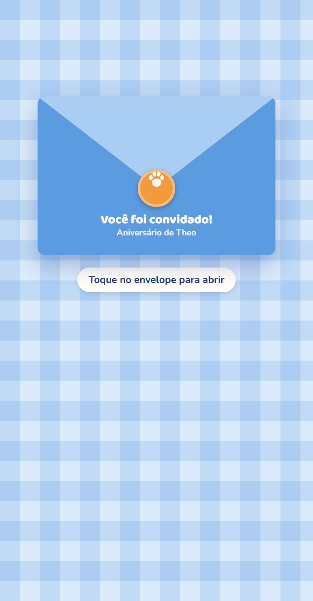

# Convite de Aniversário Digital

Convite de aniversário infantil para celular, com envelope animado, lista de tamanhos para presentes, localização da festa e confirmação de presença pelo WhatsApp.

Fiz este projeto para uma cliente real. O convidado recebe **um único link**, abre o envelope, vê o convite e confirma presença com um toque. O WhatsApp da mãe recebe uma mensagem pronta, com o nome do convidado, a quantidade de pessoas e o link do local da festa.

> Os dados da festa real (nomes, telefone, endereço e arte) foram trocados por dados de exemplo neste repositório.

**[▶ Ver a demonstração](https://lucascamposf-dev.github.io/convite-aniversario-digital/)** (abra no celular)

| Envelope | Convite aberto | Confirmação |
|:---:|:---:|:---:|
|  |  |  |

## Funcionalidades

- **Envelope animado:** a aba abre em 3D, o selo some e o convite sai de dentro do envelope.
- **Uma tela só no celular:** a arte se ajusta à altura da tela, e tocar nela amplia em tela cheia.
- **Botão de confirmar sempre visível:** fica fixo no rodapé e abre uma janela de baixo para cima.
- **Mensagem pronta no WhatsApp:** inclui o nome do convidado, a quantidade de pessoas e o link do local, para o convidado achar o endereço depois no próprio WhatsApp.
- **Tamanhos para presentes:** mostra roupa e sapato da criança, para quem quiser levar presente.
- **Local da festa:** botões que abrem o Google Maps e o Waze direto no ponto da festa.
- **Aviso de rolagem:** em telas baixas, uma seta avisa que há mais informações abaixo.

## Decisões técnicas

| Decisão | Motivo |
|---|---|
| Um único `index.html` sem dependências, só HTML, CSS e JavaScript | O site é descartável: é só publicar e usar, sem build. |
| Todos os dados da festa num objeto `FESTA` no topo do script | Para outra festa, troca-se só a configuração, sem mexer no código. |
| Link `wa.me` com o texto em `encodeURIComponent` | Abre a conversa com a mensagem já escrita, no app ou no WhatsApp Web, sem API paga. |
| Envelope feito com `clip-path` e `rotateX` + `perspective` | A animação usa só CSS, sem imagens nem bibliotecas. |
| Arte com altura máxima de `100svh` menos o espaço do resto da tela | No celular, o convite e as ações principais aparecem sem precisar rolar. |
| `env(safe-area-inset-*)` | Respeita o notch e a barra de gestos do iPhone e do Android. |

**Acessibilidade:**
- `prefers-reduced-motion` desliga as animações para quem pede menos movimento.
- Os campos têm rótulos, as mensagens de erro são ligadas ao campo com `aria-describedby` e os diálogos têm `aria-modal`.
- O foco do teclado fica visível, e a tecla Esc fecha as janelas.
- Os campos usam fonte de 16px, para o iOS não dar zoom ao tocar.

## Como usar em outra festa

1. Troque a arte por uma imagem 2:3 (ex.: 1024×1536) e aponte `arte` para ela.
2. Edite o objeto `FESTA` no fim do `index.html`:

```js
var FESTA = {
  crianca: "Theo",
  idade: "1 aninho",
  data: "15/11",
  hora: "16h",
  mae: "Ana",
  whatsapp: "11987654321",       // com DDD; vazio = modo demonstração
  arte: "convite-exemplo.svg",
  tamanhos: [
    { item: "Roupa",  tamanho: "2 a 3 anos" },
    { item: "Sapato", tamanho: "20 a 22" }
  ],
  localNome: "Parque Ibirapuera",
  endereco: "São Paulo, SP",
  coordenadas: "-23.587416,-46.657634"
};
```

3. Publique a pasta em qualquer hospedagem estática: Netlify, GitHub Pages ou Vercel.
4. Para a prévia com imagem no WhatsApp, adicione `og:url` e `og:image` com o endereço absoluto do site.

Com `whatsapp` vazio, o convite fica em **modo demonstração**: o WhatsApp abre e o próprio usuário escolhe o contato. Assim nenhuma mensagem vai para um número real por engano.

## Estrutura

```
index.html            convite completo (HTML, CSS e JS)
convite-exemplo.svg   arte de exemplo
docs/                 capturas de tela usadas neste README
```
